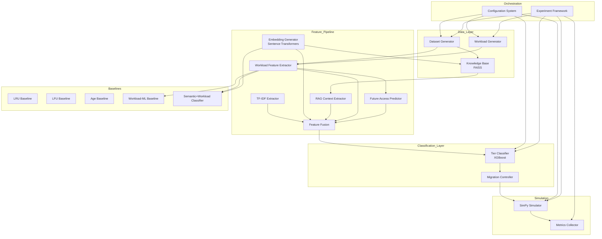
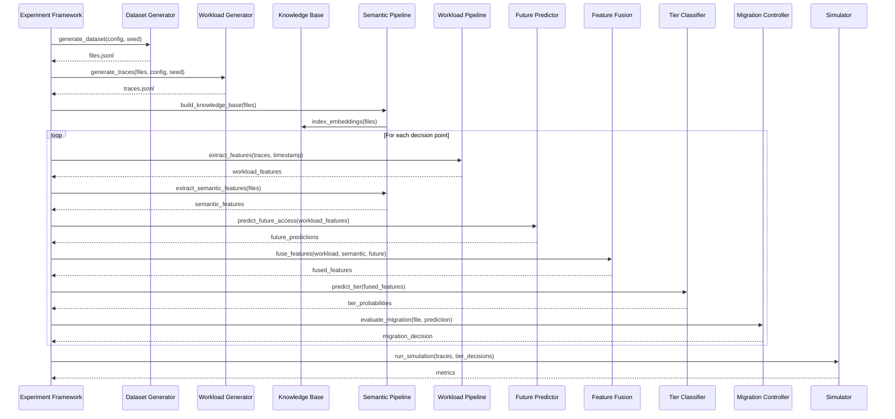
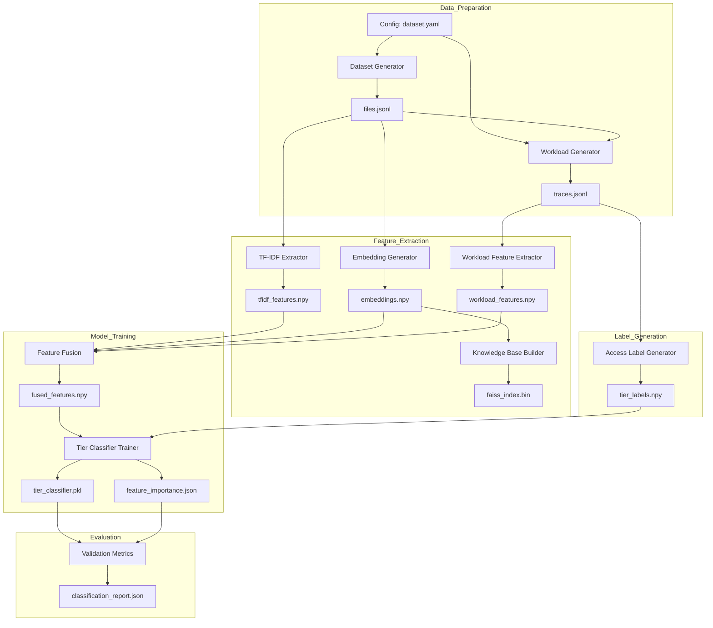
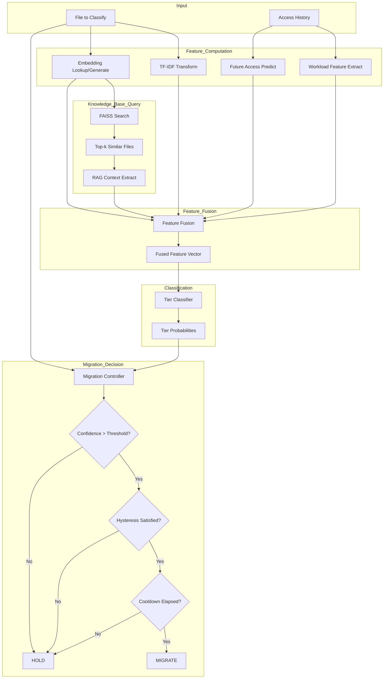
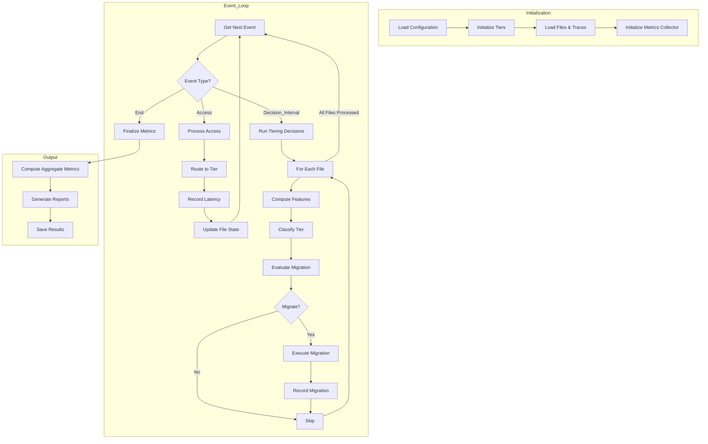

# Design Document: Context-Aware Predictive Storage Tiering

## Overview

The Context-Aware Predictive Storage Tiering system is a simulation framework for evaluating whether semantic and contextual information retrieved through RAG, combined with workload characteristics and predicted future access patterns, can improve storage-tier placement decisions compared to conventional and workload-only tiering policies.

### Design Goals

1. **Modularity**: Components are independently testable and swappable for ablation experiments
2. **Reproducibility**: All stochastic processes are seed-controlled; configurations are versioned
3. **Data Leakage Prevention**: Strict temporal causality in feature computation and model training
4. **Extensibility**: New baselines, feature extractors, and classifiers can be added without modifying core infrastructure

### System Context

The system operates entirely offline for experiments - no production storage system integration required. It simulates storage tier behavior using discrete event simulation (SimPy) to measure the impact of different tiering policies on cost, latency, and migration overhead.

---

## Architecture

### High-Level Architecture



### Component Interaction Diagram



### Module Organization

```
src/tiering/
├── __init__.py
├── ingestion/
│   ├── __init__.py
│   ├── dataset_generator.py      # Synthetic file generation
│   ├── workload_generator.py     # Access trace generation
│   └── schemas.py                # Pydantic data models
├── semantic/
│   ├── __init__.py
│   ├── tfidf_extractor.py        # TF-IDF feature extraction
│   ├── embedding_generator.py    # Sentence Transformer embeddings
│   ├── knowledge_base.py         # FAISS vector store wrapper
│   ├── rag_extractor.py          # RAG context extraction
│   └── fallback.py               # Deterministic fallback
├── workload/
│   ├── __init__.py
│   ├── feature_extractor.py      # Time-series feature computation
│   └── seasonality.py            # Pattern detection algorithms
├── prediction/
│   ├── __init__.py
│   ├── future_predictor.py       # XGBoost access probability model
│   └── feature_engineering.py    # Time-series feature engineering
├── models/
│   ├── __init__.py
│   ├── tier_classifier.py        # XGBoost multiclass model
│   ├── feature_fusion.py         # Feature concatenation/imputation
│   └── training.py               # Training pipeline
├── migration/
│   ├── __init__.py
│   ├── controller.py             # Policy-based migration decisions
│   └── cost_model.py             # Migration cost calculation
├── simulation/
│   ├── __init__.py
│   ├── simulator.py              # SimPy discrete event simulator
│   ├── tier.py                   # Tier modeling
│   └── metrics.py                # Metrics collection
├── baselines/
│   ├── __init__.py
│   ├── lru.py                    # LRU baseline
│   ├── lfu.py                    # LFU baseline
│   ├── age_based.py              # Age-based baseline
│   ├── workload_ml.py            # Workload-only ML baseline
│   └── semantic_workload.py      # Semantic+Workload classifier
└── config/
    ├── __init__.py
    ├── loader.py                 # YAML configuration loading
    └── validation.py             # Config schema validation
```

---

## Components and Interfaces

### Ingestion Module

#### DatasetGenerator

```python
class DatasetGenerator:
    """Generates synthetic enterprise datasets with realistic category distributions."""
    
    def __init__(self, config: DatasetConfig, seed: int):
        """
        Initialize generator with configuration and random seed.
        
        Args:
            config: DatasetConfig with categories, size distribution, content templates
            seed: Random seed for reproducibility
        """
        ...
    
    def generate(self, num_files: int) -> List[FileDocument]:
        """
        Generate synthetic files across enterprise categories.
        
        Returns:
            List of FileDocument instances with unique IDs, categories, content, metadata
        """
        ...
    
    def to_jsonl(self, files: List[FileDocument], path: Path) -> None:
        """Write files to JSON Lines format with schema validation."""
        ...
```

#### WorkloadGenerator

```python
class WorkloadGenerator:
    """Generates realistic access traces with configurable patterns."""
    
    def __init__(self, config: WorkloadConfig, seed: int):
        """
        Initialize generator with pattern distribution and seed.
        
        Args:
            config: WorkloadConfig with pattern ratios, time parameters
            seed: Random seed for reproducibility
        """
        ...
    
    def generate_traces(
        self, 
        files: List[FileDocument], 
        duration_hours: float,
        start_time: datetime
    ) -> List[AccessEvent]:
        """
        Generate access traces for files over simulation duration.
        
        Returns:
            Chronologically sorted list of AccessEvent instances
        """
        ...
    
    def assign_patterns(
        self, 
        files: List[FileDocument]
    ) -> Dict[str, WorkloadPattern]:
        """
        Assign workload patterns (hot/warm/cold/seasonal) to files.
        
        Returns:
            Mapping from file_id to WorkloadPattern specification
        """
        ...
```

### Semantic Pipeline

#### TFIDFExtractor

```python
class TFIDFExtractor:
    """Extracts TF-IDF features from document content."""
    
    def __init__(self, config: TFIDFConfig):
        """
        Initialize with preprocessing and vectorization settings.
        
        Args:
            config: TFIDFConfig with max_features, ngram_range, stopwords settings
        """
        ...
    
    def fit(self, documents: List[str]) -> None:
        """Fit TF-IDF vectorizer on document corpus."""
        ...
    
    def transform(self, documents: List[str]) -> np.ndarray:
        """
        Transform documents to TF-IDF vectors.
        
        Returns:
            Array of shape (n_documents, n_features) with float32 dtype
        """
        ...
    
    def fit_transform(self, documents: List[str]) -> np.ndarray:
        """Fit and transform in one step."""
        ...
    
    def save(self, path: Path) -> None:
        """Persist vectorizer to disk."""
        ...
    
    @classmethod
    def load(cls, path: Path) -> 'TFIDFExtractor':
        """Load vectorizer from disk."""
        ...
```

#### EmbeddingGenerator

```python
class EmbeddingGenerator:
    """Generates dense embeddings using Sentence Transformers."""
    
    def __init__(self, config: EmbeddingConfig):
        """
        Initialize with model selection and batch settings.
        
        Args:
            config: EmbeddingConfig with model_name, device, batch_size
        """
        ...
    
    def encode(self, texts: List[str]) -> np.ndarray:
        """
        Generate embeddings for texts with batching.
        
        Returns:
            Array of shape (n_texts, embedding_dim) with float32 dtype
        """
        ...
    
    def encode_with_metadata(
        self, 
        files: List[FileDocument]
    ) -> List[EmbeddingRecord]:
        """
        Generate embeddings including metadata in input text.
        
        Returns:
            List of EmbeddingRecord with file_id, embedding, model_version
        """
        ...
```

#### KnowledgeBase

```python
class KnowledgeBase:
    """FAISS vector store for semantic similarity search."""
    
    def __init__(self, config: KnowledgeBaseConfig):
        """
        Initialize FAISS index with dimension and metric settings.
        
        Args:
            config: KnowledgeBaseConfig with index_type, n_clusters, metric
        """
        ...
    
    def add(self, embeddings: np.ndarray, file_ids: List[str]) -> None:
        """Add embeddings with associated file IDs to index."""
        ...
    
    def search(
        self, 
        query: np.ndarray, 
        k: int
    ) -> Tuple[np.ndarray, List[List[str]]]:
        """
        Search for k most similar documents.
        
        Returns:
            Tuple of (distances, file_id_lists) for each query
        """
        ...
    
    def save(self, path: Path) -> None:
        """Persist FAISS index and ID mapping to disk."""
        ...
    
    @classmethod
    def load(cls, path: Path) -> 'KnowledgeBase':
        """Load FAISS index from disk."""
        ...
```

#### RAGContextExtractor

```python
class RAGContextExtractor:
    """Extracts contextual features using RAG."""
    
    def __init__(
        self, 
        knowledge_base: KnowledgeBase,
        config: RAGConfig
    ):
        """
        Initialize with knowledge base and LLM settings.
        
        Args:
            knowledge_base: FAISS vector store for retrieval
            config: RAGConfig with top_k, prompt_template, fallback settings
        """
        ...
    
    def extract(
        self, 
        file: FileDocument,
        access_history: List[AccessEvent]
    ) -> RAGContext:
        """
        Extract contextual features for a file.
        
        Returns:
            RAGContext with category_confidence, related_files, 
            context_summary, feature_vector
        """
        ...
    
    def _build_prompt(
        self, 
        file: FileDocument, 
        retrieved: List[RetrievalResult],
        access_history: List[AccessEvent]
    ) -> str:
        """Construct prompt for LLM with file context and retrieved documents."""
        ...
    
    def _fallback_extraction(
        self, 
        file: FileDocument,
        retrieved: List[RetrievalResult]
    ) -> RAGContext:
        """
        Deterministic keyword-based extraction when LLM unavailable.
        
        Uses TF-IDF similarity scores and category co-occurrence statistics.
        """
        ...
```

### Workload Pipeline

#### WorkloadFeatureExtractor

```python
class WorkloadFeatureExtractor:
    """Computes time-series features from access traces."""
    
    def __init__(self, config: WorkloadFeatureConfig):
        """
        Initialize with window sizes and feature settings.
        
        Args:
            config: WorkloadFeatureConfig with window_sizes, normalization settings
        """
        ...
    
    def extract(
        self, 
        events: List[AccessEvent],
        reference_time: datetime
    ) -> WorkloadFeatures:
        """
        Extract workload features from historical events.
        
        Only uses events before reference_time to prevent data leakage.
        
        Returns:
            WorkloadFeatures with counts, recency, inter_arrival, periodicity
        """
        ...
    
    def extract_batch(
        self, 
        events_by_file: Dict[str, List[AccessEvent]],
        reference_time: datetime
    ) -> Dict[str, WorkloadFeatures]:
        """Extract features for multiple files efficiently."""
        ...
    
    def to_vector(self, features: WorkloadFeatures) -> np.ndarray:
        """Convert WorkloadFeatures to normalized numpy array."""
        ...
```

#### SeasonalityDetector

```python
class SeasonalityDetector:
    """Detects periodic patterns in access traces."""
    
    def __init__(self, config: SeasonalityConfig):
        """
        Initialize with detection parameters.
        
        Args:
            config: SeasonalityConfig with min_period, max_period, confidence_threshold
        """
        ...
    
    def detect(self, events: List[AccessEvent]) -> Optional[SeasonalityResult]:
        """
        Detect seasonal patterns using autocorrelation analysis.
        
        Returns:
            SeasonalityResult with period, amplitude, phase if detected; None otherwise
        """
        ...
    
    def compute_autocorrelation(
        self, 
        counts: np.ndarray, 
        max_lag: int
    ) -> np.ndarray:
        """Compute autocorrelation for time-lagged access counts."""
        ...
```

### Prediction Module

#### FutureAccessPredictor

```python
class FutureAccessPredictor:
    """XGBoost regression model for access probability prediction."""
    
    def __init__(self, config: PredictorConfig):
        """
        Initialize with model hyperparameters.
        
        Args:
            config: PredictorConfig with xgboost_params, prediction_window, calibration
        """
        ...
    
    def fit(
        self, 
        X: np.ndarray, 
        y: np.ndarray,
        eval_set: Optional[Tuple[np.ndarray, np.ndarray]] = None
    ) -> None:
        """
        Train the XGBoost model with time-series features.
        
        Args:
            X: Feature matrix (n_samples, n_features)
            y: Binary labels indicating access in prediction window
            eval_set: Optional validation set for early stopping
        """
        ...
    
    def predict(self, X: np.ndarray) -> np.ndarray:
        """
        Predict access probability for feature vectors.
        
        Returns:
            Array of shape (n_samples,) with probability scores in [0, 1]
        """
        ...
    
    def get_feature_importance(self) -> Dict[str, float]:
        """Get feature importance rankings from XGBoost model."""
        ...
    
    def save(self, path: Path) -> None:
        """Save model with version identifier."""
        ...
    
    @classmethod
    def load(cls, path: Path) -> 'FutureAccessPredictor':
        """Load model from disk."""
        ...
```

### Models Module

#### FeatureFusion

```python
class FeatureFusion:
    """Combines workload, semantic, and future-access features."""
    
    def __init__(self, config: FusionConfig):
        """
        Initialize with imputation and scaling settings.
        
        Args:
            config: FusionConfig with imputation_strategy, scaling, ablation_flags
        """
        ...
    
    def fuse(
        self,
        workload: Optional[np.ndarray],
        semantic: Optional[np.ndarray],
        future: Optional[np.ndarray]
    ) -> np.ndarray:
        """
        Concatenate features with missing feature imputation.
        
        Returns:
            Fused feature vector with shape (n_samples, total_dim)
        """
        ...
    
    def get_feature_names(self) -> List[str]:
        """Get names for each feature dimension for interpretability."""
        ...
    
    def set_ablation(self, disable_features: List[str]) -> None:
        """
        Disable specific feature types for ablation experiments.
        
        Args:
            disable_features: List of feature types to disable 
                              ('workload', 'semantic', 'future')
        """
        ...
```

#### TierClassifier

```python
class TierClassifier:
    """XGBoost multiclass classifier for tier placement."""
    
    def __init__(self, config: ClassifierConfig):
        """
        Initialize with model hyperparameters.
        
        Args:
            config: ClassifierConfig with xgboost_params, num_classes, class_weights
        """
        ...
    
    def fit(
        self, 
        X: np.ndarray, 
        y: np.ndarray,
        eval_set: Optional[Tuple[np.ndarray, np.ndarray]] = None
    ) -> 'TierClassifier':
        """
        Train the XGBoost multiclass model.
        
        Args:
            X: Feature matrix (n_samples, n_features)
            y: Tier labels (0=HOT, 1=WARM, 2=COLD)
            eval_set: Optional validation set for early stopping
            
        Returns:
            self for method chaining
        """
        ...
    
    def predict(self, X: np.ndarray) -> np.ndarray:
        """
        Predict tier class for feature vectors.
        
        Returns:
            Array of shape (n_samples,) with tier labels
        """
        ...
    
    def predict_proba(self, X: np.ndarray) -> np.ndarray:
        """
        Predict probability distribution over tier classes.
        
        Returns:
            Array of shape (n_samples, 3) with probabilities for [HOT, WARM, COLD]
        """
        ...
    
    def get_feature_importance(self, importance_type: str = 'gain') -> np.ndarray:
        """Get feature importance from XGBoost model."""
        ...
    
    def compute_shap_values(self, X: np.ndarray) -> np.ndarray:
        """Compute SHAP values for interpretability analysis."""
        ...
    
    def classification_report(
        self, 
        X: np.ndarray, 
        y: np.ndarray
    ) -> Dict[str, Any]:
        """
        Generate classification report with precision, recall, F1 per class.
        
        Returns:
            Dict with metrics and confusion matrix
        """
        ...
    
    def save(self, path: Path, version: str) -> None:
        """Save model with version identifier."""
        ...
    
    @classmethod
    def load(cls, path: Path) -> 'TierClassifier':
        """Load model from disk."""
        ...
```

### Migration Module

#### MigrationController

```python
class MigrationController:
    """Policy-based migration decision controller."""
    
    def __init__(self, config: MigrationConfig):
        """
        Initialize with policy parameters.
        
        Args:
            config: MigrationConfig with confidence_threshold, hysteresis_count,
                   cooldown_hours, cost_weights
        """
        ...
    
    def evaluate(
        self,
        file_id: str,
        current_tier: Tier,
        predicted_tier: Tier,
        probability: float,
        timestamp: datetime
    ) -> MigrationDecision:
        """
        Evaluate whether to migrate a file.
        
        Applies confidence threshold, hysteresis, and cooldown checks.
        
        Returns:
            MigrationDecision with action, rationale, and estimated cost
        """
        ...
    
    def get_migration_cost(
        self,
        file_size: int,
        source_tier: Tier,
        dest_tier: Tier
    ) -> MigrationCost:
        """Calculate migration cost including latency and bandwidth."""
        ...
    
    def reset_file_state(self, file_id: str) -> None:
        """Reset hysteresis counter for a file (e.g., after migration)."""
        ...
```

### Simulation Module

#### SimPySimulator

```python
class SimPySimulator:
    """Discrete event simulator for storage tier behavior."""
    
    def __init__(
        self, 
        config: SimulationConfig,
        tiers: Dict[Tier, TierConfig],
        migration_controller: MigrationController
    ):
        """
        Initialize simulator with tier configurations.
        
        Args:
            config: SimulationConfig with duration, decision_interval, seed
            tiers: Mapping of tier enum to TierConfig (latency, throughput, cost)
            migration_controller: Controller for tier transition decisions
        """
        ...
    
    def run(
        self, 
        files: List[FileDocument],
        traces: List[AccessEvent],
        classifier: Optional[TierClassifier] = None
    ) -> SimulationResult:
        """
        Run simulation with event processing.
        
        Args:
            files: List of files to simulate
            traces: Access events in chronological order
            classifier: Optional ML classifier (None for baseline-only simulation)
            
        Returns:
            SimulationResult with metrics, migration log, tier states over time
        """
        ...
    
    def _process_access(self, event: AccessEvent) -> None:
        """Process a single access event, routing to appropriate tier."""
        ...
    
    def _run_tiering_decision(self) -> None:
        """Run tiering decision for all files at decision interval."""
        ...
    
    def _execute_migration(
        self, 
        file_id: str, 
        source: Tier, 
        dest: Tier
    ) -> None:
        """Execute tier migration with latency modeling."""
        ...
```

#### MetricsCollector

```python
class MetricsCollector:
    """Collects and aggregates simulation metrics."""
    
    def __init__(self):
        """Initialize metric accumulators."""
        ...
    
    def record_access(
        self, 
        tier: Tier, 
        latency: float, 
        is_hit: bool
    ) -> None:
        """Record an access event."""
        ...
    
    def record_migration(
        self, 
        file_id: str,
        source: Tier,
        dest: Tier,
        cost: float
    ) -> None:
        """Record a migration event."""
        ...
    
    def compute_metrics(self) -> SimulationMetrics:
        """
        Compute aggregate metrics.
        
        Returns:
            SimulationMetrics with classification, cost, latency, migration metrics
        """
        ...
    
    def to_json(self) -> Dict[str, Any]:
        """Export metrics as JSON-serializable dict."""
        ...
    
    def generate_plots(self, output_dir: Path) -> List[Path]:
        """Generate visualization plots for key metrics."""
        ...
```

### Baselines Module

#### LRUBaseline

```python
class LRUBaseline:
    """LRU (Least Recently Used) tiering policy."""
    
    def __init__(self, config: BaselineConfig):
        """
        Initialize with tier capacity limits.
        
        Args:
            config: BaselineConfig with tier_capacities
        """
        ...
    
    def get_tier(self, file_id: str) -> Tier:
        """Get current tier for a file."""
        ...
    
    def on_access(self, file_id: str, timestamp: datetime) -> Optional[Tier]:
        """
        Update tier state on access.
        
        Promotes file to HOT tier, may demote LRU files if capacity exceeded.
        
        Returns:
            New tier if migration occurred, None otherwise
        """
        ...
    
    def on_decision_interval(self) -> List[MigrationDecision]:
        """
        Process decision interval (demotion of cold files).
        
        Returns:
            List of migration decisions for demotion candidates
        """
        ...
```

#### LFUBaseline

```python
class LFUBaseline:
    """LFU (Least Frequently Used) tiering policy."""
    
    def __init__(self, config: BaselineConfig):
        """
        Initialize with frequency counting window.
        
        Args:
            config: BaselineConfig with tier_capacities, frequency_window
        """
        ...
    
    def on_access(self, file_id: str, timestamp: datetime) -> Optional[Tier]:
        """Update frequency count and potentially promote."""
        ...
    
    def on_decision_interval(self) -> List[MigrationDecision]:
        """Demote least frequently accessed files."""
        ...
```

#### AgeBasedBaseline

```python
class AgeBasedBaseline:
    """Age-based tiering policy."""
    
    def __init__(self, config: AgeBaselineConfig):
        """
        Initialize with age thresholds.
        
        Args:
            config: AgeBaselineConfig with age_thresholds per tier transition
        """
        ...
    
    def on_decision_interval(
        self, 
        files: List[FileDocument],
        timestamp: datetime
    ) -> List[MigrationDecision]:
        """
        Migrate files based on age thresholds.
        
        Returns:
            List of migration decisions for files crossing age thresholds
        """
        ...
```

---

## Data Models

### File/Document Schema

```python
from pydantic import BaseModel, Field
from datetime import datetime
from typing import Optional, Dict, Any
from enum import Enum

class Category(str, Enum):
    FINANCE = "Finance"
    LEGAL = "Legal"
    HR = "HR"
    ENGINEERING = "Engineering"
    RESEARCH = "Research"
    MARKETING = "Marketing"
    OPERATIONS = "Operations"
    SECURITY = "Security"
    SYSTEM = "System"

class FileDocument(BaseModel):
    """Represents a file in the synthetic dataset."""
    file_id: str = Field(..., description="Unique identifier")
    filename: str = Field(..., description="Generated filename")
    category: Category = Field(..., description="Enterprise category")
    content: str = Field(..., description="Text content")
    metadata: Dict[str, Any] = Field(default_factory=dict)
    size_bytes: int = Field(..., ge=0, description="File size")
    created_at: datetime = Field(..., description="Creation timestamp")
    modified_at: datetime = Field(..., description="Last modification timestamp")
    
    class Config:
        use_enum_values = True
```

### Access Event Schema

```python
class OperationType(str, Enum):
    READ = "read"
    WRITE = "write"

class AccessEvent(BaseModel):
    """Represents a file access event in the trace."""
    timestamp: datetime = Field(..., description="Event timestamp with nanosecond precision")
    file_id: str = Field(..., description="Referenced file")
    operation: OperationType = Field(..., description="Access type")
    size_bytes: Optional[int] = Field(None, description="Bytes transferred")
    
    class Config:
        json_encoders = {
            datetime: lambda v: v.isoformat()
        }
```

### Tier Configuration Schema

```python
class Tier(str, Enum):
    HOT = "HOT"
    WARM = "WARM"
    COLD = "COLD"

class TierConfig(BaseModel):
    """Configuration for a storage tier."""
    tier: Tier
    latency_ms: float = Field(..., ge=0, description="Average access latency in milliseconds")
    cost_per_gb_month: float = Field(..., ge=0, description="Storage cost per GB per month")
    capacity_gb: float = Field(..., gt=0, description="Maximum capacity in GB")
    throughput_mbps: float = Field(..., ge=0, description="Throughput in MB/s")
    
    class Config:
        use_enum_values = True
```

### Feature Vector Schemas

```python
class WorkloadFeatures(BaseModel):
    """Time-series features from access patterns."""
    file_id: str
    
    # Access counts
    access_count_1h: int = Field(ge=0)
    access_count_24h: int = Field(ge=0)
    access_count_7d: int = Field(ge=0)
    access_count_30d: int = Field(ge=0)
    
    # Recency metrics
    last_access_hours: float = Field(ge=0)
    time_since_creation_hours: float = Field(ge=0)
    
    # Inter-arrival statistics
    mean_inter_arrival_hours: float = Field(ge=0)
    std_inter_arrival_hours: float = Field(ge=0)
    
    # Pattern indicators
    read_write_ratio: float = Field(ge=0)
    periodicity_score: float = Field(ge=0, le=1)
    
    def to_vector(self) -> np.ndarray:
        """Convert to numpy array for ML input."""
        ...

class SemanticFeatures(BaseModel):
    """Semantic features from content analysis."""
    file_id: str
    tfidf_vector: Optional[List[float]] = None
    embedding_vector: Optional[List[float]] = None
    category_confidence: float = Field(ge=0, le=1)
    
    def to_vector(self) -> np.ndarray:
        """Convert to numpy array for ML input."""
        ...

class RAGContext(BaseModel):
    """Contextual features from RAG extraction."""
    file_id: str
    category_confidence: float = Field(ge=0.0, le=1.0)
    related_files: List[str] = Field(default_factory=list)
    context_summary: str = Field(default="")
    feature_vector: List[float] = Field(default_factory=list)
    
    class Config:
        # Validate category_confidence range
        validate_assignment = True

class FuturePrediction(BaseModel):
    """Future access probability prediction."""
    file_id: str
    access_probability: float = Field(ge=0.0, le=1.0)
    prediction_window_hours: int = Field(gt=0)
    confidence: float = Field(ge=0.0, le=1.0)

class FusedFeatures(BaseModel):
    """Combined feature representation."""
    file_id: str
    workload_vector: List[float]
    semantic_vector: List[float]
    future_vector: List[float]
    fused_vector: List[float]
    
    # Metadata for interpretability
    feature_contributions: Dict[str, float] = Field(default_factory=dict)
```

### Knowledge Base Schema

```python
class EmbeddingRecord(BaseModel):
    """Single embedding entry in the knowledge base."""
    file_id: str
    embedding: List[float]
    model_version: str
    created_at: datetime

class RetrievalResult(BaseModel):
    """Result from knowledge base retrieval."""
    file_id: str
    distance: float = Field(ge=0)
    category: Category
    
class KnowledgeBaseIndex(BaseModel):
    """Metadata for the FAISS index."""
    index_type: str  # "Flat", "IVF", "HNSW"
    dimension: int
    metric: str  # "L2", "IP", "cosine"
    num_vectors: int
    model_version: str
    created_at: datetime
```

---

## Correctness Properties

*A property is a characteristic or behavior that should hold true across all valid executions of a system—essentially, a formal statement about what the system should do. Properties serve as the bridge between human-readable specifications and machine-verifiable correctness guarantees.*

### Property 1: Dataset Generation Reproducibility

*For any* given random seed and configuration, the DatasetGenerator SHALL produce identical output (file IDs, categories, sizes, timestamps) on all subsequent runs with the same seed and configuration.

**Validates: Requirements 1.3, 1.5**

### Property 2: Dataset Schema Compliance

*For any* generated file, all required fields (file_id, category, created_at, size_bytes, metadata) SHALL be present with valid types, and category SHALL be one of the nine enterprise categories.

**Validates: Requirements 1.1, 1.2, 1.6**

### Property 3: Workload Trace Chronological Ordering

*For any* generated workload trace, all events SHALL be in strictly chronological order with nanosecond timestamp precision.

**Validates: Requirements 2.3, 2.5**

### Property 4: Feature Vector Dimension Consistency

*For any* feature extraction component (TF-IDF, Embedding, Workload) and any valid input documents/events, all output vectors SHALL have identical dimensions regardless of input size or content.

**Validates: Requirements 3.3, 3.5, 4.1, 4.2, 6.4**

### Property 5: RAG Output Schema Validation

*For any* RAG context extraction output, the JSON SHALL validate against the Pydantic RAGContext model with category_confidence in [0.0, 1.0], feature_vector with consistent dimensions, and related_files as a list of strings.

**Validates: Requirements 5.3, 22.1, 22.4**

### Property 6: Knowledge Base Retrieval Limit

*For any* search query with top-k parameter, the KnowledgeBase SHALL return at most k results sorted by distance in ascending order.

**Validates: Requirements 5.1, 5.6**

### Property 7: Temporal Integrity in Feature Computation

*For any* feature extraction operation with reference_time T, all features SHALL be computed exclusively from events with timestamp < T, preventing data leakage.

**Validates: Requirements 6.5, 7.4, 21.1, 21.2, 21.3**

### Property 8: Seasonality Detection Accuracy

*For any* access trace with synthetic seasonal pattern of period P, the SeasonalityDetector SHALL detect periodicity within configurable tolerance of P.

**Validates: Requirements 2.6, 6.3**

### Property 9: Model Probability Calibration

*For any* input feature vector, the FutureAccessPredictor SHALL output probability in [0.0, 1.0], and the TierClassifier predict_proba output SHALL sum to 1.0 across all three tier classes with all values in [0.0, 1.0].

**Validates: Requirements 7.3, 9.2, 15.4, 16.4**

### Property 10: Migration Confidence Threshold

*For any* tier prediction with maximum probability below the configured confidence threshold, the MigrationController SHALL not execute a migration.

**Validates: Requirements 10.1**

### Property 11: Migration Hysteresis Enforcement

*For any* file, the MigrationController SHALL not migrate to tier X until the prediction for tier X has been sustained for at least N consecutive decision points (where N is the hysteresis count).

**Validates: Requirements 10.2**

### Property 12: Migration Cooldown Enforcement

*For any* file migrated at time T with cooldown period C, the MigrationController SHALL not approve another migration for that file until time T + C.

**Validates: Requirements 10.3**

### Property 13: Feature Fusion Dimension Preservation

*For any* combination of valid workload, semantic, and future feature vectors, the fused feature vector SHALL have dimension equal to the sum of input dimensions; when a feature type is disabled via ablation, corresponding dimensions SHALL be zero.

**Validates: Requirements 8.1, 8.2, 8.4**

### Property 14: Simulation Event Causality

*For any* simulation run, events SHALL be processed in strictly chronological order, and no event's effects SHALL influence events with earlier timestamps.

**Validates: Requirements 11.2, 21.4**

### Property 15: Simulation Reproducibility

*For any* simulation configuration with a specified seed, identical runs SHALL produce identical metrics, migration logs, and tier states.

**Validates: Requirements 11.5, 20.3, 20.5**

### Property 16: Configuration Validation

*For any* configuration file, the Config_System SHALL validate against JSON schema before component initialization, rejecting invalid configurations with descriptive error messages.

**Validates: Requirements 20.1, 20.6**

### Property 17: Cold-Start Prior Application

*For any* file with access history below the minimum threshold, the FutureAccessPredictor SHALL apply category-level priors instead of returning invalid predictions.

**Validates: Requirements 7.6**

### Property 18: Deterministic Fallback Behavior

*For any* file and knowledge base state, the deterministic fallback extraction SHALL produce identical outputs for identical inputs, with valid RAGContext schema.

**Validates: Requirements 5.4, 23.1, 23.2**

### Property 19: Baseline Tier Capacity Enforcement

*For any* baseline policy (LRU, LFU, Age) with configured tier capacities, the total size of files in each tier SHALL not exceed the capacity limit.

**Validates: Requirements 12.3, 13.3**

### Property 20: Metrics Computation Correctness

*For any* simulation with known access patterns and migrations, computed metrics (latency percentiles, storage costs, migration counts) SHALL match expected values based on tier configurations.

**Validates: Requirements 11.4, 19.1, 19.2, 19.3, 19.4**

---

## Error Handling

### Error Categories

| Category | Description | Handling Strategy |
|----------|-------------|-------------------|
| Configuration Errors | Invalid YAML, missing required fields, constraint violations | Fail fast with descriptive error message; no execution |
| Data Validation Errors | Schema validation failures, out-of-range values | Log warning, skip invalid record, continue processing |
| Model Errors | Training failures, prediction errors | Fallback to baseline policy, log error |
| Resource Errors | Out of memory, disk full | Graceful shutdown with checkpoint if supported |
| External Service Errors | LLM unavailable, embedding model load failure | Fallback to deterministic mode, log event |

### Error Handling Patterns

```python
class TieringError(Exception):
    """Base exception for tiering system errors."""
    def __init__(self, message: str, component: str, recoverable: bool = False):
        self.message = message
        self.component = component
        self.recoverable = recoverable
        super().__init__(message)

class ConfigurationError(TieringError):
    """Configuration validation failure."""
    def __init__(self, message: str, config_path: str):
        super().__init__(message, "Configuration", recoverable=False)
        self.config_path = config_path

class DataValidationError(TieringError):
    """Data schema validation failure."""
    def __init__(self, message: str, file_id: str, field: str):
        super().__init__(message, "DataValidation", recoverable=True)
        self.file_id = file_id
        self.field = field

class ModelError(TieringError):
    """Model training or inference failure."""
    def __init__(self, message: str, model_name: str, fallback_available: bool):
        super().__init__(message, "Model", recoverable=fallback_available)
        self.model_name = model_name
        self.fallback_available = fallback_available

class DataLeakageError(TieringError):
    """Detected data leakage in feature computation."""
    def __init__(self, message: str, component: str, timestamp: datetime):
        super().__init__(message, component, recoverable=False)
        self.timestamp = timestamp
```

### Fallback Mechanisms

1. **RAG Fallback**: When LLM service is unavailable, the RAG layer falls back to deterministic keyword-based extraction using TF-IDF similarity (Requirement 5.4, 23.1)

2. **Embedding Fallback**: When GPU is unavailable, embedding generation falls back to CPU processing (Requirement 4.5)

3. **Model Fallback**: When classifier fails, system falls back to LRU baseline policy

4. **Cold-Start Handling**: Files with insufficient history use category-level priors for prediction (Requirement 7.6)

---

## Testing Strategy

### Unit Tests

Unit tests verify specific examples, edge cases, and error conditions.

**Test Categories:**
1. **Data Model Tests**: Validate Pydantic schemas, serialization/deserialization
2. **Feature Extraction Tests**: Verify feature computation with fixed inputs
3. **Model Tests**: Verify prediction behavior with mock data
4. **Policy Tests**: Verify migration controller decisions with known states
5. **Baseline Tests**: Verify baseline policies with simple access patterns

**Example Unit Tests:**
```python
def test_workload_extractor_empty_history():
    """Verify extractor handles files with no access history."""
    extractor = WorkloadFeatureExtractor(config)
    features = extractor.extract([], reference_time=datetime.now())
    assert features.access_count_1h == 0
    assert features.last_access_hours == float('inf')

def test_migration_controller_cooldown():
    """Verify cooldown period is enforced."""
    controller = MigrationController(config)
    decision1 = controller.evaluate(
        file_id="f1", current_tier=Tier.WARM, 
        predicted_tier=Tier.HOT, probability=0.9, 
        timestamp=datetime(2024, 1, 1, 12, 0)
    )
    assert decision1.action == MigrationAction.MIGRATE
    
    decision2 = controller.evaluate(
        file_id="f1", current_tier=Tier.HOT,
        predicted_tier=Tier.WARM, probability=0.9,
        timestamp=datetime(2024, 1, 1, 12, 1)  # Within cooldown
    )
    assert decision2.action == MigrationAction.HOLD
    assert "cooldown" in decision2.rationale.lower()
```

### Property-Based Tests

Property-based tests verify universal properties across all inputs. The system uses `hypothesis` library for Python property-based testing.

**Configuration:**
- Minimum 100 iterations per property test
- Each test tagged with: `# Feature: context-aware-predictive-tiering, Property N: [property_text]`

**Property Test Examples:**

```python
from hypothesis import given, settings
from hypothesis.strategies import integers, floats, text, builds, one_of
from datetime import datetime, timedelta

# Property 1: Dataset Generation Reproducibility
@given(seed=integers(min_value=0, max_value=2**32 - 1))
@settings(max_examples=100)
def test_dataset_reproducibility(seed):
    """Property 1: For any seed, identical runs produce identical output."""
    config = DatasetConfig(num_files=100)
    
    gen1 = DatasetGenerator(config, seed)
    files1 = gen1.generate()
    
    gen2 = DatasetGenerator(config, seed)
    files2 = gen2.generate()
    
    assert [f.file_id for f in files1] == [f.file_id for f in files2]
    assert [f.category for f in files1] == [f.category for f in files2]
    # Feature: context-aware-predictive-tiering, Property 1: Dataset Generation Reproducibility

# Property 6: Workload Feature Temporal Integrity
@given(
    events=st.lists(builds(AccessEvent), min_size=0, max_size=100),
    reference_time=st.datetimes()
)
@settings(max_examples=100)
def test_workload_temporal_integrity(events, reference_time):
    """Property 6: Features computed only from events before reference_time."""
    # Filter events to only those before reference_time
    valid_events = [e for e in events if e.timestamp < reference_time]
    
    extractor = WorkloadFeatureExtractor(config)
    features = extractor.extract(events, reference_time)
    
    # Verify no future events influenced features
    if valid_events:
        expected_count = len([e for e in valid_events if 
                             reference_time - e.timestamp < timedelta(hours=1)])
        assert features.access_count_1h == expected_count
    # Feature: context-aware-predictive-tiering, Property 6: Workload Feature Temporal Integrity

# Property 8: Tier Classifier Probability Sum
@given(features=st.lists(floats(min_value=-10, max_value=10), min_size=50, max_size=50))
@settings(max_examples=100)
def test_classifier_probability_sum(features):
    """Property 8: Probability outputs sum to 1.0."""
    classifier = TierClassifier.load("models/tier_classifier_v1.pkl")
    X = np.array(features).reshape(1, -1)
    
    probs = classifier.predict_proba(X)
    
    assert probs.shape == (1, 3)
    assert np.isclose(probs.sum(), 1.0, atol=1e-6)
    assert np.all(probs >= 0) and np.all(probs <= 1)
    # Feature: context-aware-predictive-tiering, Property 8: Tier Classifier Probability Sum

# Property 9: Migration Cooldown Enforcement
@given(
    file_id=st.text(min_size=1, max_size=20),
    migrate_time=st.floats(min_value=0, max_value=1000),
    check_time=st.floats(min_value=0, max_value=100)
)
@settings(max_examples=100)
def test_migration_cooldown(file_id, migrate_time, check_time):
    """Property 9: No migration within cooldown period."""
    config = MigrationConfig(cooldown_hours=24)
    controller = MigrationController(config)
    
    migrate_dt = datetime(2024, 1, 1) + timedelta(hours=migrate_time)
    check_dt = migrate_dt + timedelta(hours=check_time)
    
    # Simulate initial migration
    controller.evaluate(file_id, Tier.WARM, Tier.HOT, 0.9, migrate_dt)
    
    # Check within cooldown
    if check_time < 24:
        decision = controller.evaluate(file_id, Tier.HOT, Tier.COLD, 0.9, check_dt)
        assert decision.action in [MigrationAction.HOLD, MigrationAction.NONE]
    # Feature: context-aware-predictive-tiering, Property 9: Migration Cooldown Enforcement
```

### Integration Tests

Integration tests verify end-to-end workflows:

1. **Training Pipeline**: Dataset generation → Feature extraction → Model training
2. **Inference Pipeline**: Feature extraction → Prediction → Migration decision
3. **Simulation Pipeline**: Trace generation → Event processing → Metrics collection
4. **Baseline Comparison**: Run all baselines on same dataset, verify metric differences

### Test Data Fixtures

```python
# conftest.py
@pytest.fixture
def sample_dataset():
    """Generate small reproducible dataset for testing."""
    config = DatasetConfig(num_files=100, seed=42)
    gen = DatasetGenerator(config, seed=42)
    return gen.generate()

@pytest.fixture
def sample_traces(sample_dataset):
    """Generate access traces for sample dataset."""
    config = WorkloadConfig(duration_hours=24)
    gen = WorkloadGenerator(config, seed=42)
    return gen.generate_traces(sample_dataset, duration_hours=24)

@pytest.fixture
def trained_classifier(sample_dataset, sample_traces):
    """Train classifier on sample data."""
    # ... training logic
    return classifier
```

---

## Performance Considerations

### Batch Processing

**Embedding Generation:**
- Process documents in batches of 32-64 for GPU utilization
- Batch size configurable via `EmbeddingConfig.batch_size`
- Automatic gradient accumulation for memory efficiency

**Feature Extraction:**
- Vectorized NumPy operations for statistical computations
- Parallel processing across files using `multiprocessing.Pool`

### Vector Store Optimization

**FAISS Index Selection:**
- Small datasets (< 100K vectors): Flat index (exact search)
- Medium datasets (100K - 1M): IVF with n_clusters = sqrt(n)
- Large datasets (> 1M): HNSW or IVF with PQ compression

**Index Building:**
- Build index once at experiment start
- Persist to disk for reuse across runs
- Incremental updates supported for dynamic datasets

### Simulation Performance

**Event Processing:**
- Use SimPy's event queue for efficient scheduling
- Batch tiering decisions at configurable intervals
- Lazy evaluation of features (compute only when needed)

**Memory Management:**
- Stream large trace files instead of loading entirely into memory
- Use generators for file iteration
- Clear intermediate state between simulation runs

---

## Reproducibility Mechanisms

### Random Seed Management

```python
class SeedManager:
    """Centralized seed management for reproducibility."""
    
    def __init__(self, master_seed: int):
        """
        Initialize with master seed.
        
        Derives component-specific seeds deterministically.
        """
        self.master_seed = master_seed
        self._derive_seeds()
    
    def _derive_seeds(self):
        """Derive seeds for each component from master seed."""
        rng = np.random.default_rng(self.master_seed)
        self.dataset_seed = rng.integers(0, 2**32)
        self.workload_seed = rng.integers(0, 2**32)
        self.model_seed = rng.integers(0, 2**32)
        self.simulation_seed = rng.integers(0, 2**32)
    
    def get_seed(self, component: str) -> int:
        """Get seed for specific component."""
        return getattr(self, f"{component}_seed")
```

### Versioning Strategy

**Dataset Versioning:**
```python
def generate_dataset_version(config: DatasetConfig, seed: int) -> str:
    """Generate unique version identifier for dataset."""
    config_hash = hashlib.sha256(
        json.dumps(config.dict(), sort_keys=True).encode()
    ).hexdigest()[:8]
    return f"dataset_{config_hash}_seed{seed}"
```

**Model Versioning:**
```python
def generate_model_version(
    config: ClassifierConfig, 
    train_data_hash: str,
    timestamp: datetime
) -> str:
    """Generate unique version identifier for trained model."""
    return f"model_{timestamp.strftime('%Y%m%d_%H%M%S')}_{train_data_hash[:8]}"
```

### Configuration Snapshots

```python
class ConfigSnapshot:
    """Immutable snapshot of all configurations for an experiment."""
    
    def __init__(self, configs: Dict[str, BaseModel]):
        self.configs = configs
        self.timestamp = datetime.utcnow()
        self.snapshot_id = self._generate_id()
    
    def _generate_id(self) -> str:
        """Generate unique snapshot ID."""
        content = json.dumps(
            {k: v.dict() for k, v in self.configs.items()},
            sort_keys=True,
            default=str
        )
        return hashlib.sha256(content.encode()).hexdigest()[:12]
    
    def save(self, path: Path) -> None:
        """Save snapshot to JSON file."""
        with open(path, 'w') as f:
            json.dump({
                'snapshot_id': self.snapshot_id,
                'timestamp': self.timestamp.isoformat(),
                'configs': {k: v.dict() for k, v in self.configs.items()}
            }, f, indent=2)
```

---

## Technology Stack

### Core Libraries

| Component | Library | Version | Purpose |
|-----------|---------|---------|---------|
| ML Models | xgboost | >= 1.7.0 | Gradient boosting for classification/regression |
| Feature Engineering | scikit-learn | >= 1.2.0 | TF-IDF, preprocessing, metrics |
| Embeddings | sentence-transformers | >= 2.2.0 | Dense document embeddings |
| Vector Store | faiss-cpu / faiss-gpu | >= 1.7.0 | Efficient similarity search |
| Simulation | simpy | >= 4.0.0 | Discrete event simulation |
| Interpretability | shap | >= 0.41.0 | Feature importance analysis |

### Configuration & Validation

| Library | Version | Purpose |
|---------|---------|---------|
| pydantic | >= 2.0.0 | Data model validation |
| pyyaml | >= 6.0 | Configuration file loading |
| jsonschema | >= 4.0.0 | JSON schema validation |

### Testing

| Library | Version | Purpose |
|---------|---------|---------|
| pytest | >= 7.0.0 | Test framework |
| hypothesis | >= 6.0.0 | Property-based testing |
| pytest-cov | >= 4.0.0 | Coverage reporting |

### Visualization

| Library | Version | Purpose |
|---------|---------|---------|
| matplotlib | >= 3.6.0 | Plotting |
| seaborn | >= 0.12.0 | Statistical visualization |
| shap | >= 0.41.0 | SHAP plots |

### Requirements File

```
# requirements.txt
xgboost>=1.7.0
scikit-learn>=1.2.0
sentence-transformers>=2.2.0
faiss-cpu>=1.7.0  # or faiss-gpu for GPU support
simpy>=4.0.0
shap>=0.41.0

pydantic>=2.0.0
pyyaml>=6.0
jsonschema>=4.0.0

pytest>=7.0.0
hypothesis>=6.0.0
pytest-cov>=4.0.0

matplotlib>=3.6.0
seaborn>=0.12.0
pandas>=1.5.0
numpy>=1.23.0
tqdm>=4.64.0
```

---

## Data Flow Diagrams

### Training Pipeline Flow



### Inference/Classification Flow



### Simulation Event Processing Flow



---

## Design Decisions and Rationales

### Decision 1: XGBoost for Classification

**Decision**: Use XGBoost for both tier classification and future access prediction.

**Rationale**:
- Handles mixed feature types (numerical, categorical) without extensive preprocessing
- Provides native feature importance for interpretability
- Well-suited for tabular data with non-linear relationships
- Fast inference for simulation workloads
- SHAP integration for detailed interpretability analysis

**Alternatives Considered**:
- Neural networks: Would require more data, less interpretable
- Random forests: Slower inference, less feature importance precision
- Logistic regression: Cannot capture non-linear feature interactions

### Decision 2: FAISS for Vector Store

**Decision**: Use FAISS for knowledge base vector storage and retrieval.

**Rationale**:
- Production-grade performance for large-scale similarity search
- Multiple index types for different scale requirements
- CPU and GPU variants available
- Mature library with Python bindings
- Supports incremental index updates

### Decision 3: SimPy for Simulation

**Decision**: Use SimPy for discrete event simulation.

**Rationale**:
- Pure Python, no external dependencies beyond standard library
- Explicit event-based model matches domain (storage tier events)
- Easy to inject custom decision logic at event boundaries
- Supports reproducible simulations with seed control

### Decision 4: Three-Level Semantic Pipeline

**Decision**: Implement TF-IDF, Sentence Transformers, and RAG as separate, composable layers.

**Rationale**:
- Enables ablation experiments isolating each level's contribution
- TF-IDF provides fast, deterministic baseline
- Sentence Transformers capture semantic similarity
- RAG adds contextual reasoning without requiring LLM for core functionality
- Graceful degradation when LLM unavailable

### Decision 5: Strict Temporal Causality

**Decision**: Enforce strict temporal ordering in all feature computation and model training.

**Rationale**:
- Prevents data leakage that would invalidate experimental conclusions
- Matches real-world constraints (cannot use future information at decision time)
- Enables valid comparison between approaches
- Critical for publishable research results

---

## Appendix: Configuration Schema

### Dataset Configuration

```yaml
# configs/dataset.yaml
dataset:
  num_files: 10000
  categories:
    - Finance
    - Legal
    - HR
    - Engineering
    - Research
    - Marketing
    - Operations
    - Security
    - System
  category_distribution:
    Finance: 0.15
    Legal: 0.10
    HR: 0.10
    Engineering: 0.20
    Research: 0.15
    Marketing: 0.10
    Operations: 0.10
    Security: 0.05
    System: 0.05
  size_distribution:
    min_bytes: 1024
    max_bytes: 104857600
    distribution: lognormal
  seed: 42
```

### Model Configuration

```yaml
# configs/models.yaml
tier_classifier:
  xgboost_params:
    n_estimators: 200
    max_depth: 6
    learning_rate: 0.1
    objective: multi:softprob
    num_class: 3
    eval_metric: mlogloss
    early_stopping_rounds: 20
  class_weights:
    HOT: 1.0
    WARM: 1.0
    COLD: 1.0

future_predictor:
  xgboost_params:
    n_estimators: 100
    max_depth: 4
    learning_rate: 0.05
    objective: binary:logistic
  prediction_window_hours: 24
  calibration_method: isotonic

embedding:
  model_name: all-MiniLM-L6-v2
  device: cuda
  batch_size: 32

tfidf:
  max_features: 5000
  ngram_range: [1, 2]
  stop_words: english
  use_stemming: true
```

### Migration Configuration

```yaml
# configs/migration.yaml
migration:
  confidence_threshold: 0.7
  hysteresis_count: 3
  cooldown_hours: 24
  cost_model:
    latency_weight: 0.3
    bandwidth_weight: 0.2
    storage_weight: 0.5
  policies:
    - name: conservative
      confidence_threshold: 0.8
      hysteresis_count: 5
    - name: aggressive
      confidence_threshold: 0.6
      hysteresis_count: 2
```

### Simulation Configuration

```yaml
# configs/simulation.yaml
simulation:
  duration_hours: 168
  decision_interval_hours: 1
  seed: 42

tiers:
  HOT:
    latency_ms: 1.0
    cost_per_gb_month: 0.10
    capacity_gb: 100.0
    throughput_mbps: 500.0
  WARM:
    latency_ms: 10.0
    cost_per_gb_month: 0.02
    capacity_gb: 500.0
    throughput_mbps: 100.0
  COLD:
    latency_ms: 100.0
    cost_per_gb_month: 0.004
    capacity_gb: 5000.0
    throughput_mbps: 10.0
```
