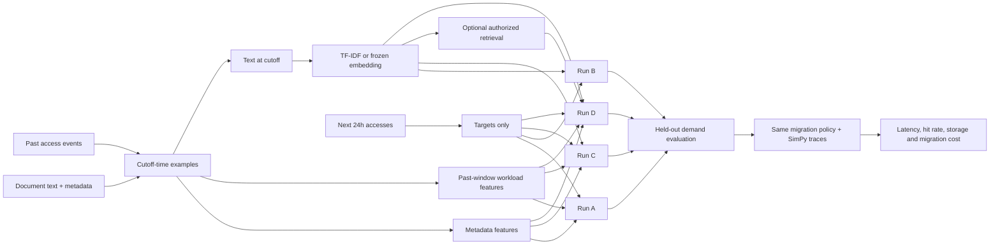

# Semantic Predictive Storage Tiering

Research code for testing one product question:

> Does document meaning improve predictions of future file demand, and do those improved predictions lead to better storage-tier outcomes under the same workload and capacity constraints?

The project compares metadata and access-history baselines against matched models that also use document text. Predictions feed a migration policy and SimPy storage simulation. News-topic classification is an optional NLP benchmark; it does not train or validate the storage-tiering product.

## Experiment design

For each document at a prediction cutoff, the model may use only information available by that cutoff. The initial target is the number of accesses during the following 24 hours, with a secondary target of whether the file is accessed at all. HOT/WARM/COLD are an operational mapping from future demand, not labels supplied by an enterprise storage system.

| Run | Inputs | Question answered |
|---|---|---|
| A: metadata + workload | File metadata and past access history | How well can conventional product signals predict demand? |
| B: semantic only | Document text representation | Does document meaning carry demand signal by itself? |
| C: combined | Run A inputs plus text representation | Does semantics add value beyond metadata and access history? |
| D: combined + retrieval | Run C plus permission-filtered, past-only neighbor statistics | Does retrieved context add value beyond the document itself? |

Use identical examples, targets, time splits, model family, and tuning budget for each comparison. Run D is a later ablation; retrieval-augmented generation is not required for the first semantic experiment. See [the product data contract](docs/PRODUCT_DATA_CONTRACT.md) and [the experiment plan](SEMANTIC_TIERING_PLAN.md).

## Architecture



The experiment must keep file IDs, future access events, future-derived labels, and test-period information out of model inputs and fitting. Evaluate chronologically and report unseen-file performance separately from future-period performance on known files. Wikimedia page views can provide a public demand proxy, but they are web attention rather than enterprise file-system access logs; simulated tier outcomes remain a simulation, not production evidence. Current Hugging Face candidate coverage, join status, and limitations are documented in [docs/DATASET_FEASIBILITY.md](docs/DATASET_FEASIBILITY.md).

## Data

The core data contract has two linked tables:

- **Documents:** stable document ID, text/content, created/modified time, size, type/category and other metadata available at the cutoff.
- **Access events:** document ID, timestamp, operation and optional bytes transferred.

Each training example is keyed by document ID and prediction cutoff. Features come from document state and events at or before the cutoff. Targets come from events in `(cutoff, cutoff + 24h]`. See [docs/PRODUCT_DATA_CONTRACT.md](docs/PRODUCT_DATA_CONTRACT.md) for the full schema, split rules, and public-data caveats.

## Install

Requirements: Python 3.10 or newer. Core dependencies are in `pyproject.toml`; sentence-transformer and vector-search dependencies are optional.

```powershell
py -3.13 -m venv .venv
.\.venv\Scripts\Activate.ps1
python -m pip install --upgrade pip
python -m pip install -e ".[dev]"
```

Install optional semantic embedding dependencies when using Sentence Transformers:

```powershell
python -m pip install -e ".[semantic]"
```

## Current commands

Generate a small synthetic dataset and workload:

```powershell
python -m src.tiering.cli generate --num-files 100 --duration-hours 24
```

Train the existing synthetic workload/metadata tier and future-access pilots, then run their simulation comparison:

```powershell
python -m src.tiering.experiments.train_synthetic_tiering_models
```

Run the matched A/B/C/D product ablation (metadata + workload, semantic-only, combined, and combined with retrieval context) with chronological evaluation and a SimPy warm-up/test boundary:

```powershell
python -m src.tiering.experiments.product_ablation
```

This writes `results/metrics/product_ablation_synthetic.json`, `results/models/product_ablation_synthetic.joblib`, and row-level cutoff examples in `results/datasets/product_cutoff_examples.jsonl`. Retrieval requires shared explicit `metadata.access_groups`; the synthetic generator provides none, so D retrieves no neighbors in the default run.

Make a single HOT/WARM/COLD recommendation with recent access history and document text:

```powershell
python -m src.tiering.prediction.mvp examples/mvp_input.json
```

The input format is demonstrated in `examples/mvp_input.json`. The command uses the combined A/B/C prototype artifact, returns tier probabilities and estimated next-24-hour demand, and rejects access events after the supplied cutoff. Run the product ablation first if the model artifact is missing. Predictions are an MVP demonstration based on synthetic training traces.

Clean the downloaded AG News, Reuters-21578, and 20 Newsgroups data for the optional text-classification benchmark:

```powershell
python -m pip install -e ".[data]"
python -m src.tiering.ingestion.clean_news_datasets
```

News benchmark models can be trained with `python -m src.tiering.models.news_training --dataset ag_news --model xgboost`; supported datasets are `ag_news`, `reuters21578`, and `20_newsgroups`. These results answer topic-classification questions only.

## Current implementation status

The repository has synthetic file/access generation, metadata and workload feature extraction, and a first matched A/B/C product ablation using content-only TF-IDF, future-demand targets, separate known-file and unseen-file test reports, and SimPy evaluation after a history warm-up cutoff. The synthetic generator assigns content and workload patterns independently, so its semantic scores are pipeline checks rather than evidence that semantics helps. Remaining revamp work includes a verified public text/access dataset adapter, additional seeds and representations, retrieval-context run D, and external-trace evaluation.

Existing benchmark results and their limitations are summarized in [docs/BENCHMARK_RESULTS.md](docs/BENCHMARK_RESULTS.md). Dataset options and verified limitations are in [docs/DATASET_FEASIBILITY.md](docs/DATASET_FEASIBILITY.md). Technique roles are explained in [docs/theory.md](docs/theory.md). Treat synthetic metrics as pipeline checks, not evidence of enterprise performance.

## Tests

```powershell
python -m pytest -q
```

The latest recorded passing result may predate subsequent training and simulator changes; consult the implementation plan and rerun validation before relying on it.

## Project map

- `src/tiering/ingestion/`: synthetic documents, access traces, and news cleaning
- `src/tiering/workload/`: past-access feature extraction and seasonality
- `src/tiering/semantic/`: TF-IDF, embeddings, vector retrieval, and RAG fallback
- `src/tiering/models/` and `src/tiering/prediction/`: model implementations and training helpers
- `src/tiering/migration/`, `src/tiering/baselines/`, `src/tiering/simulation/`: policies and system simulation
- `src/tiering/experiments/`: experiment runners and current synthetic pilots
- `configs/default.yaml`: reproducible default settings
