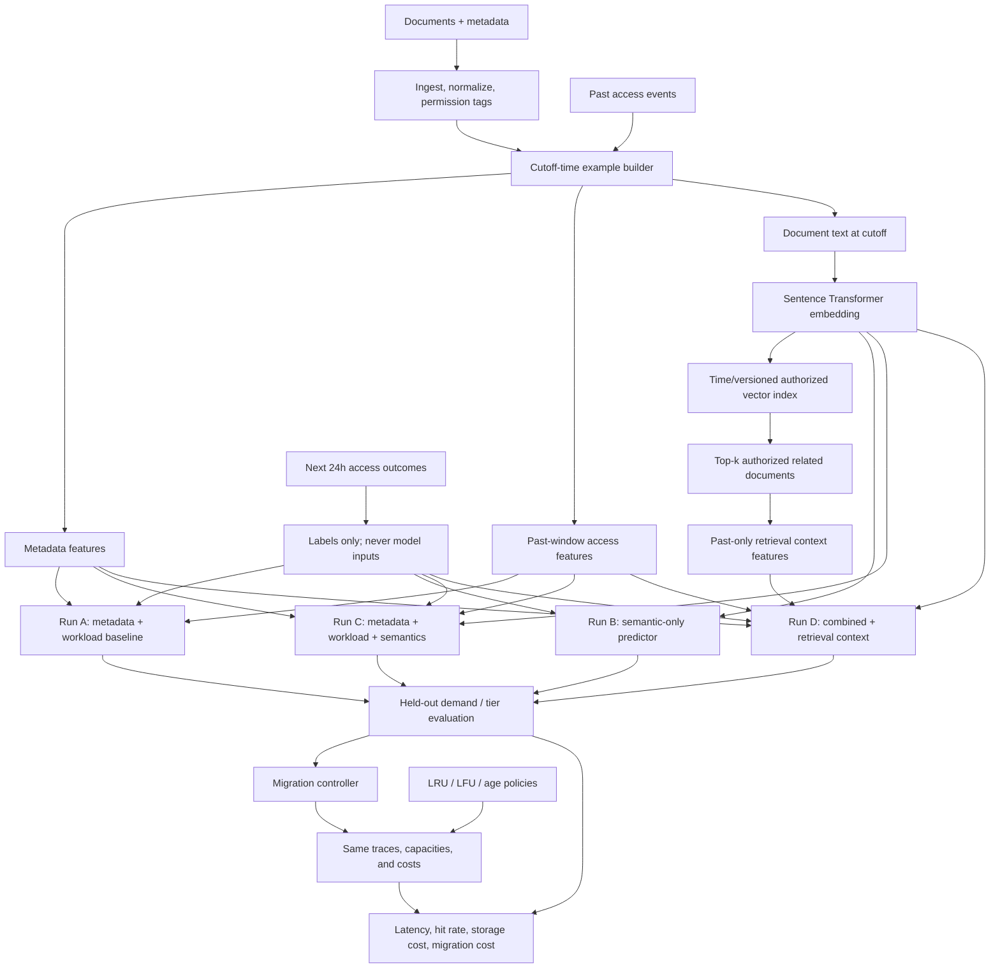

# Product-Focused Semantic Tiering Experiment

## Goal

Test whether document meaning improves storage-tier decisions beyond file metadata and past access behavior. The result must be stated in product terms: whether adding semantic information improves future-demand prediction or simulated storage outcomes under the same workload and storage constraints.

News-topic classification is not part of this experiment. Its label-prediction results do not establish that semantics improves file tiering; keep those runs as an optional text-model benchmark only.

## Revamp status — 2026-10-31

The first product-aligned implementation is in place:

- `docs/PRODUCT_DATA_CONTRACT.md` defines the document/access-event schema, cutoff-time features, future-access targets, splits, and public-data caveats.
- `src/tiering/experiments/product_ablation.py` runs matched A/B/C XGBoost comparisons: metadata + workload, content-only TF-IDF, and combined features. It uses the same seed, files, target windows, and train/validation/test cutoffs; it fits TF-IDF on training file identities only and reports known-file and unseen-file test results separately.
- SimPy can now warm up its access history before a configured evaluation cutoff. Pre-cutoff activity, storage charges, and migrations are excluded from evaluation metrics. Storage and migration costs are now reported separately.
- The first synthetic run is recorded in `docs/BENCHMARK_RESULTS.md`. A and C tied on unseen-file tier macro-F1 (1.000); the synthetic generator assigns each file's persistent access pattern independently of its content. B was much worse on unseen files. Its perfect known-file tier score is consistent with content vectors acting as per-file fingerprints, so it is not evidence that document meaning predicts demand. These results are pipeline checks, not an enterprise claim.

The run completed and wrote `results/metrics/product_ablation_synthetic.json` and `results/models/product_ablation_synthetic.joblib`. A bounded dataset review is recorded in `docs/DATASET_FEASIBILITY.md`: the daily top-100 page-view set is small but censored, and the FineWiki/raw-series ID join is unverified. A local title-join coverage tool is available at `src/tiering/ingestion/validate_wikipedia_join.py`; it has not yet been run because the source files are not present locally. The test suite has not yet been run against the simulator/schema changes. Embedding ablations and retrieval run D remain future work.

## Experiment design

For every file at each prediction timestamp, build one example with:

- **Observed inputs:** metadata and access history available at the timestamp.
- **Optional semantic inputs:** document embedding and, only as a separately measured ablation, features derived from similar documents retrieved from the authorized corpus.
- **Targets:** primary target is the number of accesses in the following 24 hours. Also report any-access probability. HOT/WARM/COLD may be reported as an operational mapping of future demand, with cutoffs declared before evaluation; do not present simulator-generated cutoffs as enterprise ground truth.

Run matched models on identical examples, labels, splits, classifier family, and tuning budget:

| Run | Inputs | Purpose |
|---|---|---|
| A: workload + metadata baseline | Past access features and file metadata | Establish current non-semantic performance |
| B: semantic only | Document embedding | Measure the standalone semantic signal |
| C: combined | Workload + metadata + document embedding | Test whether meaning adds signal beyond ordinary product features |
| D: combined + retrieval context | Run C plus features from top-k related documents | Test whether retrieval relationships add further value |

Use the same model family for A–D in the primary comparison. The primary semantic contribution score is the unseen-file result; known-file temporal results are secondary because static text vectors may identify a document and let the model memorize its demand pattern. A secondary model-family comparison can follow after the input contribution is understood.

## Implementation phases

### 1. Define the product target and data contract

- Define the prediction timestamp, historical lookback windows, 24-hour label window, and operational HOT/WARM/COLD mapping in one config.
- Document required file fields, content availability, access event fields, permission metadata, and missing-value handling.
- Keep targets derived only from events after the prediction timestamp; exclude file IDs, future event fields, and target-derived fields from model inputs.
- Save a manifest with dataset provenance, row counts, file/time split rules, seed, target definition, and semantic encoder/version.

**Complete when:** one row can be traced to a file, cutoff time, legal past inputs, and a later target window.

### 2. Build leakage-safe evaluation splits

- Use chronological train, validation, and test periods.
- Add a file-identity holdout so the primary generalization score includes files never used for model fitting. Report a separate future-period score for known files if useful.
- Keep test periods and held-out file IDs unavailable to vocabulary/model tuning, semantic feature selection, threshold choices, and hyperparameter search.
- If only synthetic data is available, state that clearly and evaluate both known-file and unseen-file splits. Do not use the current random generated workload score as real-world evidence.

**Complete when:** split assignments are saved and checks confirm no prohibited file/time overlap or future leakage.

### 3. Establish and save the product baseline

- Reuse the current workload and metadata feature extraction, but name the exact feature list in the run artifact.
- Train a future-access count/probability model and a tier model only if the declared operational tier target is needed.
- Tune against validation data; evaluate once on the held-out test data.
- Save the preprocessing, model, feature names, label mapping, config, and metrics together.

**Complete when:** the baseline can be loaded and make a prediction from a single cutoff-time feature record.

### 4. Add document semantic features

- Encode the document text with a fixed, recorded Sentence Transformer model. Start frozen; do not fine-tune on the test corpus.
- Choose and document a content policy (whole document or deterministic chunks with an aggregation rule). Store embedding model/version and chunk settings.
- Cache embeddings by document content hash and model version. Missing or empty content must produce an explicit missing indicator/defined fallback, not a silent fabricated vector.
- Train Run B and Run C with the same split and target as Run A. Any dimension reduction or scaler must fit on training data only.
- First compare the embedding as a feature vector against A. RAG generation is not required for this experiment.

**Complete when:** A, B, and C are reproducible, evaluated on the same held-out examples, and semantic-vector provenance is recorded.

### 5. Add retrieval context as a separate experiment

- Index only documents available to the system at the prediction time and filter retrieval by the caller's access permissions.
- Retrieve top-k related documents; exclude the query document itself and avoid adding future access information from retrieved neighbors.
- Start with auditable numeric context features: similarity scores, number of retrieved neighbors, and aggregate *past-only* neighbor access statistics. Do not feed generated answers or labels into the tier model.
- Train Run D and compare it against Run C. Record retrieval model, index version, top-k, filters, and feature names.

**Complete when:** retrieval context can be computed at a cutoff without leaking future information or returning unauthorized documents, and D is scored against C.

### 6. Evaluate predictive and system outcomes

- Demand prediction: MAE/RMSE for counts; PR-AUC, ROC-AUC, and Brier score for any-access probability; report calibration and class balance.
- Tier prediction: confusion matrix, per-tier precision/recall/F1, macro-F1, and a majority/prior baseline.
- System evaluation: feed each model's predictions through the same migration controller and SimPy traces; compare mean/p95 latency, hot-tier hit rate, storage cost, migration cost, and migration count separately.
- Include LRU, LFU, and age-based policies under the same trace and capacity constraints.
- Run ablations A–D, repeat with multiple seeds where data generation is stochastic, and report confidence intervals or mean/spread.
- Publish feature importance or grouped ablation effects; do not treat embedding coordinates as individually interpretable.

**Complete when:** the report answers whether C improves over A and whether D improves over C, for both prediction and product-level metrics.

### 7. Update product docs and checkpoints

- Make the product architecture and README describe semantic tiering as the central experiment and news classification as optional.
- Replace synthetic-only claims with qualified evidence and data provenance.
- Update Kiro checkboxes only when the acceptance evidence above exists.
- Run the project test suite and documented experiment commands after integration changes; record exact versions and outcomes.

## Revised architecture

The news-topic benchmark is outside this product path. It may remain as an optional NLP baseline exercise, but its scores must not be used to claim that semantic tiering works.

## Current starting point and remaining work

Existing pieces include synthetic file/access generation, workload and metadata features, A/B/C/D model training, prediction, retrieval filters, migration control, and SimPy comparison. The prototype exports 504 cutoff examples to `results/datasets/product_cutoff_examples.jsonl` and reports metrics in `results/metrics/product_ablation_synthetic.json`. D excludes the query document, requires shared explicit access groups, checks text availability times, and aggregates neighbor accesses only through the cutoff. The synthetic corpus has no access groups, so its D context is empty and does not measure retrieval benefit. Static text is excluded after its eligible cutoff, and the MVP refuses text modified after the prediction cutoff. The software path is integrated, but real versioned text, ACLs, and real file-access logs are still required to evaluate the architecture against enterprise behavior. Synthetic access patterns remain independent of content.
