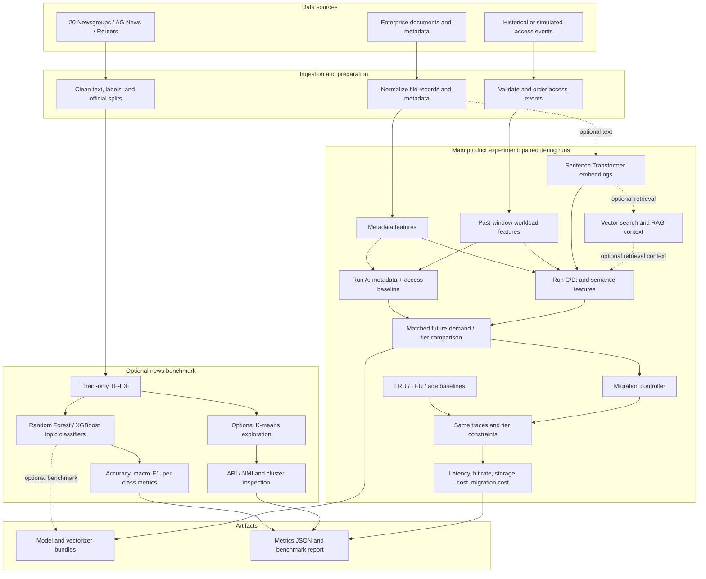
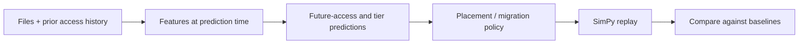

# Techniques and Their Roles in the Pipeline

This document explains what each technique is for, where it fits, and what the current project code actually does. The product experiment is storage tiering: test whether document meaning improves tier decisions beyond metadata and access history. The news-text benchmark is optional side work; its topic labels are not storage-tier labels and its scores do not answer the product question. See [SEMANTIC_TIERING_PLAN.md](../SEMANTIC_TIERING_PLAN.md) for the implementation sequence and acceptance criteria.

## General project architecture

The repository has a product path and an optional side benchmark. The product path compares matched tier predictors with and without semantic features, then evaluates placement policies on the same access traces. News topic classification does not train the tiering policy.

The architecture expresses the intended product experiment. The existing synthetic tier benchmark covers workload/metadata prediction and a SimPy integration, but the paired semantic comparison is still to be built. Dashed lines mark the optional news benchmark and retrieval-context extension. Embeddings are the primary semantic input; RAG-style retrieval features are a separate ablation.

The main code layers are:

1. **Ingestion:** load raw corpora, file records, and access traces; normalize and validate them.
2. **Feature preparation:** produce text vectors, metadata values, and workload summaries using only information available at prediction time.
3. **Modeling:** train news-topic models separately from future-access and tier models.
4. **Decision and simulation:** send tier predictions to placement/migration logic and evaluate the policy against baselines on the same traces.
5. **Artifacts and reporting:** save reusable model bundles and metrics so runs can be reproduced and compared.

## Simplified tier decision view

The reported tier benchmark currently uses historical workload and metadata features. The implementation plan defines the next product experiment: compare that baseline with matched semantic-only, combined, and combined-plus-retrieval runs.

## Technique-to-purpose map

| Technique | Primary use in this project | Inputs and outputs | Current status |
|---|---|---|---|
| Dataset ingestion and cleaning | Turn source corpora into consistent records for experiments | Raw files → normalized text, labels, split names, metadata | Implemented for 20 Newsgroups, AG News, and Reuters-21578 |
| Metadata analysis | Understand data quality and provide stable file attributes to the tier predictor | File size, age, category, type, department, confidentiality → numeric/one-hot features | Metadata features are used by the synthetic tier benchmark; exploratory analysis is not a separate trained model |
| Workload feature extraction | Summarize how recently and frequently each file has been accessed | Past access events → rolling counts, recency, inter-arrival, read/write, periodicity features | Implemented; features must be calculated using events before the prediction time |
| TF-IDF | Represent text using weighted word/ngram counts; establish a sparse text baseline | Full cleaned article/document text → sparse TF-IDF vector | Used by the AG News, Reuters, and 20 Newsgroups topic classifiers and AG News clustering; not applied to semantic embeddings |
| Sentence Transformer embeddings | Represent meaning so text with similar semantics can be found even when it uses different words | Text or chunks → dense vectors | Optional code path in `src/tiering/semantic/`; not included in the recorded benchmark runs |
| Vector knowledge base / similarity search | Retrieve files or chunks whose dense vectors are close to a query vector | Query embedding + indexed embeddings → ranked related file IDs and similarity scores | Implemented in the semantic module; index population/retrieval is not part of the benchmark results |
| RAG context extraction | Retrieve related content to provide context for a downstream answer or decision | Query/document → relevant records and context features | `RAGContextExtractor` currently retrieves related files and builds deterministic context/features; it does not call an LLM to generate a cited natural-language answer |
| Feature fusion | Combine independent signal groups so the tier model can use them together | Workload, semantic, and future-access feature arrays → fused feature matrix | Reusable component implemented; the synthetic benchmark uses workload and metadata features, not semantic/RAG features |
| Random Forest | Supervised baseline for discrete topic labels | TF-IDF vectors + known labels → predicted topic | Trained on all three news datasets; it is a topic benchmark, not the storage-tier policy |
| XGBoost | Supervised prediction for news topics and storage behavior | Feature matrix + labels → topic, future-access, or tier prediction | Trained for news pilots and synthetic future-access/tier pilots |
| K-means / MiniBatchKMeans | Explore whether unlabeled text naturally groups into clusters | TF-IDF vectors (or optionally embeddings) → cluster assignments | AG News TF-IDF clustering pilot completed; it does not predict storage tiers |
| Future-access prediction | Estimate whether/how much a file will be used in a future time window | Past workload and metadata features → next-window access probability/count | Synthetic pilot uses a 24-hour target; evaluate with AUC/Brier in addition to threshold metrics |
| Tier classification | Choose HOT, WARM, or COLD based on expected near-future demand | Past workload and metadata features → tier class | Synthetic pilot labels tiers from next-24-hour accesses; this target rule is simulator-defined |
| LRU, LFU, and age-based policies | Provide simple non-ML baselines for a tiering comparison | Recent access, frequency, or file age → placement decision | Implemented baseline policies; comparisons should use identical traces and tier constraints |
| Migration controller | Turn tier recommendations into controlled placement changes | Predicted/current tiers plus policy constraints → migration decisions | Implemented; hysteresis/cooldown help avoid excessive movement |
| SimPy | Test policies against timestamped access events and migration delays/costs | Files, traces, policy → latency, tier hits, migrations, cost metrics | Simulation integration exists; cost metric separation is still a known limitation |
| Evaluation metrics | Quantify predictive quality and system-level behavior | Predictions/ground truth or simulation results → scores | News uses accuracy and macro-F1; multilabel Reuters also uses micro-F1; clustering uses ARI/NMI; future access uses ROC-AUC/Brier; simulation uses latency/hit/migration/cost |

## How text techniques relate

TF-IDF and Sentence Transformer embeddings are **alternative text representations**:

- TF-IDF weights terms according to their frequency in a document and rarity across the training corpus. It produces a sparse vector and is useful as a lightweight, interpretable baseline.
- Sentence Transformers encode a whole text or chunk as a dense vector intended to capture semantic similarity. A vector index compares those vectors for retrieval.
- TF-IDF is not a transformation applied to Sentence Transformer vectors. They are distinct representations and can be evaluated separately or deliberately combined as different feature groups.
- A classifier consumes features to predict a known label. Clustering groups records without using those labels during fitting. Retrieval finds relevant records for a query. These are different jobs.

## Where RAG belongs

RAG belongs in a **document question-answering or context-enrichment path**. A complete answer-generation path would:

1. Split large documents into searchable chunks while retaining file IDs, offsets, and access-control metadata.
2. Encode chunks and queries with the same embedding model and retrieve the most relevant authorized chunks.
3. Optionally rerank/filter the results and pass the retrieved passages to a language model.
4. Generate an answer grounded in those passages and return citations to the source files/chunks.

For storage tiering, retrieval can optionally add related-document or semantic-context signals to the feature fusion stage, or retrieval activity can inform which documents to prefetch. Those are hypotheses to evaluate with ablation experiments; RAG is not required to train the current tier classifier. The current `RAGContextExtractor` name describes retrieval-assisted context features, but its fallback summary is deterministic and is not an LLM-generated answer.

## Training and evaluation guardrails

- Fit vectorizers, encoders that learn from this corpus, scalers, and feature selection on training data only; use validation data for model choices and reserve test data for final scoring.
- For tier prediction, compute every feature from history strictly before its timestamp. Define labels only from the explicitly later prediction window.
- Do not use news topic accuracy as evidence that the model can place files in storage tiers. News classification and tiering have different targets and feature populations.
- Compare a proposed feature group (such as semantic embeddings or RAG-derived signals) against the workload/metadata baseline on the same temporal split. Include ablations so any gain can be attributed to that feature group.
- Evaluate the simulator policy against LRU, LFU, and age-based baselines under the same trace, tier capacities, and cost definitions. Keep storage cost and migration cost separately interpretable.

## Code and results references

- News cleaning: `src/tiering/ingestion/clean_news_datasets.py`
- News TF-IDF classifiers: `src/tiering/models/news_training.py`
- Workload features: `src/tiering/workload/feature_extractor.py`
- TF-IDF, embeddings, vector index, and context extraction: `src/tiering/semantic/`
- Feature fusion: `src/tiering/models/feature_fusion.py`
- Tier/future-access prediction and migration: `src/tiering/models/`, `src/tiering/prediction/`, `src/tiering/migration/`
- Simulation: `src/tiering/simulation/simulator.py`
- Pilot scores and feature inventory: `BENCHMARK_RESULTS.md`
